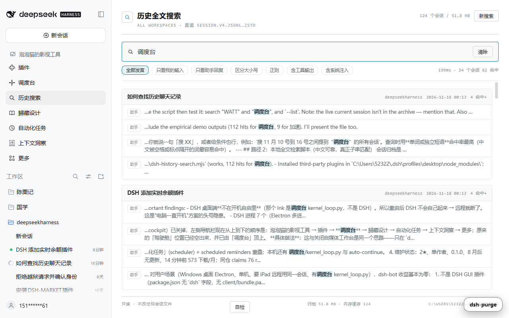
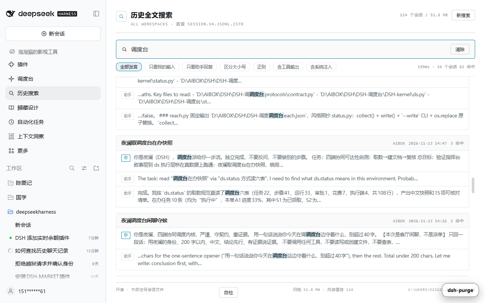

# dsh-history-search

Full-history, full-text search for **DeepSeek Harness (dsh)** — across every workspace and every archived session.

The shipped sidebar magnifier does only two things: filter sessions by **title**, and ask the host `sessions.search` for body hits inside the **sessions currently visible in the current workspace**. That leaves two hard gaps:

1. Body hits only cover "current workspace + loaded sessions" — old conversations in other workspaces are invisible;
2. The host goes through SQLite FTS5, and `quoteFtsData()` wraps the whole query as **one phrase** while the `unicode61` tokenizer does not segment CJK — so a Chinese query must match **contiguously and verbatim**. Searching `历史聊天` returns 0 hits; `加速` returns 9.

This plugin bypasses FTS5: it **decodes the `session.v4.jsonl.zstd` archives under `~/.dsh/sessions` directly** and matches with plain substring / regex. No tokenizer, so any CJK fragment matches; every workspace, every session — including ones archived long ago and no longer listed in the sidebar.



## What it ships

| Half | File | Role |
| --- | --- | --- |
| Host | `lib/index.js` | `inject: ['webServer']`, registers the prefix route `/dsh-history-search`; walks `sessions/**/session.v4.jsonl.zstd`, detects zstd by magic `0xfd2fb528` and decodes it; keeps an in-memory LRU keyed by mtime+size (260 sessions) |
| Host | `lib/zstd-frames.js` | RFC 8878 frame walker — required on the desktop host (see the multi-frame section below) |
| Client | `lib/client.js` | zero-build hand-written `window.__ModuleLoader__.load(...)`; registers a `sidebar.panellist` icon entry (order 3) and a full-page panel under `main`; follows the light/dark theme |

Panel features: 260 ms debounced input, role filter (everyone / my prompts only / assistant replies only), case-sensitive, regex, include tool output, include injected context, session-grouped results with highlighted snippets, click a row to open that session, resizable footer showing archive size and cache count.



## Published

| Channel | Where |
| --- | --- |
| Source | <https://github.com/Noeau-AI/dsh-history-search> |
| Release tarball | <https://github.com/Noeau-AI/dsh-history-search/releases/tag/v0.1.2> (`dsh-history-search-0.1.2.tgz`, 342 207 bytes, sha256 `1c4d76745483b8b60f1443ab00f5532581dae8ea8b1364ce941183de882bbafa`) |
| dsh plugin market (awesome-dsh-plugin.com) | catalog submission `data/plugins/Noeau-AI__dsh-history-search.yml` → PR [#16364](https://github.com/awesome-dsh-plugin/awesome-dsh-plugin/pull/16364); the entry shows up on the market site once that PR merges and the site rebuilds |
| npm | not published — `npm publish` from this checkout works once an npm token is configured (the name `dsh-history-search` is still free) |

## Install

### From GitHub (recommended)

```powershell
dsh plugin --profile web add github:Noeau-AI/dsh-history-search
```

Or from the prebuilt tarball attached to the GitHub Release (skips the `allowBuilds` build-approval step):

```powershell
dsh plugin --profile web add "https://github.com/Noeau-AI/dsh-history-search/releases/download/v0.1.2/dsh-history-search-0.1.2.tgz"
```

Then **fully quit and restart DeepSeek Harness** — plugins load at host start, a running instance will not hot-load one. After the restart a magnifier entry named "历史搜索 / History search" appears in the sidebar.

### From a source checkout (development)

```powershell
cd <this repo>
node tools\install.mjs            # junction in the profile's node_modules + insert entry in cordis.patch.yml
node tools\install.mjs --check    # report wiring state only
node tools\install.mjs --uninstall
```

`install.mjs` does two things:

1. Creates a **junction** at `%DSH_HOME%\profiles\<profile>\node_modules\dsh-history-search` pointing at this source directory (a junction needs no extra privileges; a legacy `@local\dsh-history-search` wiring is removed in the same run so the plugin is not loaded twice);
2. Appends to `%DSH_HOME%\profiles\<profile>\cordis.patch.yml`:

```yaml
- insert:
    - id: history-search
      name: 'dsh-history-search'
```

Every write is backed up first (`%TEMP%\dsh-history-search-backup\`, override with `DSH_HISTORY_BACKUP`) and committed as tmp-file + rename, so the script is idempotent.

## HTTP routes (for your own debugging)

```
GET /dsh-history-search/api/search?q=&role=&cs=&regex=&tools=&any=&ws=&from=&to=&limit=&per
GET /dsh-history-search/api/session?id=&from=&limit=&any=&role=
GET /dsh-history-search/api/stats
GET /dsh-history-search/api/health
GET /dsh-history-search/api/selfcheck
GET /dsh-history-search/api/reset
```

- `q` is required; missing → 400 `缺少 q 参数`
- `role`: `all` (default: user + assistant), `user`, `assistant`; `tools=1` opens tool output, `any=1` opens all injected context (`runtime-context`, `skill-catalog`, `time-context`, …)
- `cs=1` case-sensitive; `regex=1` regex mode (an invalid regex returns 400 `正则不合法：…`)
- `ws` filters by workspace slug; `from`/`to` filter by mtime (epoch ms)
- `per` = max hits per session (1–20, default 3); `limit` = max sessions returned (1–200, default 30)

`/api/selfcheck` is a live health probe: it decodes the largest archive on this machine right now and returns `node` (host runtime version), `frames`, `broken`, `decodedBytes`, `events`, `wholeFileBytes` (how much a single whole-file decode can produce) and a one-line `verdict`. The panel footer's "自检 / self-check" button calls it.

`/api/session` returns one session's transcript (the inline result's "原文 / transcript" action uses it): `id` is required (the session UUID, i.e. `sessionId` from `/api/search`); missing → 400, unknown → 404. `from` defaults to 0, `limit` to 400 (max 4000). By default it returns **conversation text only** (my messages + assistant replies); `any=1` adds injected context and tool output, and `role=user|assistant|tool|system|context` narrows it further.

```json
{ "ok": true, "id": "session-…", "workspaceSlug": "--D-AIBOX--",
  "meta": { "title": "…", "cwd": "D:\\AIBOX", "createdAt": 179… },
  "total": 178, "eventTotal": 441, "role": "conversation", "from": 0, "limit": 400,
  "records": [ { "seq": 1, "time": 179…, "role": "user", "sourceKind": "user", "text": "…" } ] }
```

Search response shape:

```json
{ "ok": true, "tookMs": 49, "totalSessions": 32, "returnedSessions": 32, "hitTotal": 66,
  "sessions": [ { "sessionId": "…", "title": "…", "cwd": "D:\\AIBOX", "workspaceSlug": "--D-AIBOX--",
                  "mtime": 1794928709803, "hitCount": 1, "truncated": false, "titleHit": false,
                  "hits": [ { "seq": 12, "time": 1794…, "role": "user",
                              "snippet": { "pre": "…", "match": "调度台", "post": "…" } } ] } ] }
```

## Measured (one machine: 123 sessions / 52.7 MB of archives)

| Query | Result |
| --- | --- |
| `stats` | 123 archives / 52.7 MB / 14 127 conversation records; cold start 2.4 s, no decode afterwards |
| `调度台` | 33 sessions / 67 hits (warm: 32–40 ms) |
| `天财` | 23 sessions / 52 hits |
| `历史聊天` | 1 session, 3 hits (the very sentence "the workspace search only looks at titles") |
| `role=user` + `调度台` | 27 sessions / 27 hits |
| invalid regex `([a-` | 400 with the parser message echoed back |

The cold-start cost is one pass of ~130k–160k frame decompressions; results are cached in memory, so later queries in the same process stay in the tens of milliseconds. `api/reset` clears the cache.

## Multi-frame zstd: why the desktop host needs its own frame walker

A session archive is not one zstd frame — it is **one frame per event batch** (a single large archive holds 2 000–7 000 frames). This is the trap that makes the plugin look fake:

```text
plain Node 24.22.1    : zlib.zstdDecompressSync(whole file) → 46 479 909 bytes, every event  ✓
desktop Electron 24.21: zlib.zstdDecompressSync(whole file) → 189 bytes, first frame only   ✗
```

The desktop host runs **Electron's bundled Node 24.21.0** (`process.versions.node`), whose `zstdDecompressSync` returns only the first frame of a multi-frame input. An early build therefore looked like this: installed, routes answering 200, `/api/stats` reporting `records: 0`, and every query returning nothing.

Fix: `lib/zstd-frames.js` walks frame boundaries per RFC 8878 (magic `0xfd2fb528`, skippable `0x184d2a50`, FHD where the FCS is one byte only for single-segment frames, 3-byte block headers `last/type/size`), decompresses frame by frame and concatenates. A truncated tail decodes up to the break and is counted in `broken`. `/api/health` reports `node`, `zstdFrames` and `zstdBroken`, so you can tell at a glance which build is running.

Both runtimes must agree — that is what `test/frames-test.mjs` pins: take the three largest archives, assert `frames > 1`, every line is valid JSON, the first line is a `session` event, and where a whole-file decode works, require the frame-by-frame output to be **byte-identical** (measured: 46 479 909 / 15 550 788 / 11 224 115 bytes, all equal). On a runtime that only returns the first frame it asserts the frame walker produces far more (`189 → 46 479 909`).

Reproduce the runtime difference with the desktop binary acting as node:

```powershell
$env:ELECTRON_RUN_AS_NODE="1"
& "<install dir>\DeepSeek Harness.exe" test\frames-test.mjs
Remove-Item Env:\ELECTRON_RUN_AS_NODE
```

## Offline tests (no host change, no restart)

```powershell
node test\frames-test.mjs       # multi-frame zstd regression (3 largest archives, both runtimes must pass)
node test\host-test.mjs         # fake ctx + mock req/res straight into the handler: health/stats/search/session/400/404
node test\client-smoke.mjs      # minimal React stub runs the factory + panel render tree, asserts slot registration and DOM shape
node test\injected-render.mjs   # extracts the patched-in component and renders 8 states + the transcript reader
```

## Optional: inline "all history" section inside the workspace search box

The sidebar entry is a standalone panel. If you would rather see cross-workspace hits **inside the workspace magnifier itself**, apply one more patch (it edits the official bundle `dsh-client-ui-workspace\lib\client.js`):

```powershell
cd <this repo>
node tools\patch-workspace-search.mjs            # apply (idempotent; no write when already applied)
node tools\patch-workspace-search.mjs --check    # component block / mount block present?
node tools\patch-workspace-search.mjs --revert   # strip back to the official bytes
```

What it injects: a `HistoryHits` component appended to the children returned by `SearchResults` — under the native "title matches + current-workspace hits" list you get a section titled "**all history · every workspace · N sessions · M hits**". Each row has a "transcript" action that expands that session's text in place (via `/api/session`) without leaving the box; clicking the row still opens the session, and if that session cannot be opened because it lives in another workspace (not in the loaded list) it falls back to the transcript view.

Patch mechanics: the component block is wrapped in `/* HSR:BEGIN */ … /* HSR:END */`, the mount point in `/* HSR:BEGIN-RENDER */ … /* HSR:END-RENDER */`; every write is backed up (default `%TEMP%\dsh-history-search-backup\`, override with `HSR_BACKUP_DIR`) and validated with `node --check` before it lands. **This patch edits an official file** — `node tools\install.mjs --uninstall` only removes the plugin wiring, use `--revert` for the patch. After an app upgrade overwrites the bundle, re-run `patch-workspace-search.mjs` (if an anchor is missing, `--revert` first).

## Jump to the exact hit (0.1.4)

Clicking a hit row opens the session **and puts the matched passage on screen** — not the bottom of the transcript.

How it gets there, in order:

1. **Wait for the right session.** The reading view keeps the previous transcript mounted for a moment, so the jump waits until `[data-conversation-session]` reports the session you clicked (up to 12 s). Without this gate it happily "found" the match inside the session you were already reading.
2. **Anchor on the turn's own question.** From `/api/session` it picks the last `user` record at or before the hit's `seq` and looks for that sentence in the DOM. The `data-chat-turn` numbers are only window-relative, so the question text is the reliable anchor.
3. **Land, expand, then refine.** It scrolls the turn into view, clicks the folded "thinking / tool" toggle when that turn is collapsed (`data-turn-process-hidden`), then searches that turn's subtree for the exact snippet.
4. **Page back when needed.** If the turn is not mounted yet it clicks "load earlier" and waits for the mounted fingerprint (`rows:textLength`) to grow before scanning again.
5. **Be honest when unreachable.** Content older than the loadable window (e.g. before a compaction checkpoint) cannot be rendered at all: the jump then moves the reader to the earliest loadable position and says so instead of pretending.

Needle matching is whitespace-aware: passages are compared with collapsed spaces (word boundaries preserved), with a space-stripped variant only for needles ≥ 24 characters — that stopped the "`e the script then test it` becomes `ethescriptthentestit`" false positives.

Fail toasts are explicit: exact hit / closest fragment / containing turn / "outside the loadable window".

## Jump to the exact hit (0.1.3)

Clicking a hit used to open the session and leave you at the bottom of a very long transcript. Since 0.1.3 the click **lands on the matched text**:

1. the session opens as usual (`uiWorkspace.openSession`);
2. the panel then walks the chat transcript's text nodes looking for the hit snippet (longest candidate first, whitespace-insensitive, so CJK line wrapping does not matter);
3. if the text is not rendered yet because it sits in an older page, the panel clicks the transcript's own `加载更早 / Load earlier` button and retries — up to 60 pages and 20 seconds;
4. on success it scrolls the row to the vertical centre and outlines it for 2.4 s (`.hsr-land`), plus a toast `已跳到命中位置`;
5. if the text never shows up (too old, or never rendered) it says so with a toast instead of silently pretending it jumped.

The chat package keeps its jump machinery (`loadThrough(seq)` + `scrollToTurn`) inside the conversation slot's injected view, which no sidebar plugin can reach, so this walks the DOM instead: `[data-conversation-scroll]` for the scrollport and `data-chat-flow-key` / `data-chat-node-key` for the rows. `test/jump-test.mjs` pins the three paths (direct hit, hit behind two older pages, hit that never appears).

## List scrolling (0.1.2)

The panel is a vertical flex stack: top toolbar + scrollable result area + footer. `.hsr-root` fills the main column and clips, `.hsr-scroll` takes the remaining height, `.hsr-body` is the only scroll container (`overflow-y:auto`, `overscroll-behavior:contain`, `max-height:calc(100vh - 240px)` as a fallback).

This is necessary because the official main column (`CenterColumn`, `.mP3x-q_centerCol` in `dsh-client-ui-layout\lib\client.js`) is itself `display:flex;flex-direction:column;overflow:hidden` — a panel that grows with `min-height:100%` has its overflow clipped, which reads as "no scrollbar and the wheel does nothing".

The scrollbar on the right is **self-drawn** (`.hsr-sb` + `.hsr-sb-thumb`) rather than the system one: Chromium on Windows defaults to overlay scrollbars, so `::-webkit-scrollbar{width:11px}` neither reserves space nor stays visible. An 11 px track and thumb handle wheel, drag and track clicks, with the thumb position synced from `clientHeight/scrollHeight` and `scrollTop`.

## Troubleshooting

| Symptom | Fix |
| --- | --- |
| No icon in the sidebar | `node tools\install.mjs --check` — junction and patch entry; make sure the desktop app was **fully restarted** |
| Panel opens but always "检索失败 / search failed" | check the wiring report; grep the host log for `dsh-history-search` |
| Cannot find something you just said | the running session is still in memory — archives only hold what has been flushed to disk |
| CJK query finds nothing | matching is plain substring; if "regex" is on, escape `(` `[` and friends |
| Broke after an app upgrade | official bundles get overwritten (the junction and patch entry usually survive); re-run `node tools\install.mjs` |
| The magnifier has no "all history" section | `node tools\patch-workspace-search.mjs --check`, then apply |
| Panel has hits but the inline section is always 0 | the host is still running the previous plugin code — restart |
| Everything returns 0 hits after install | hit `/dsh-history-search/api/health`: no `node`/`zstdFrames` fields means old code is running (restart); `records: 0` with a healthy `files` means only the first frame decoded — run `node test\frames-test.mjs` |

## Notes

- Read-only: the plugin never writes to `~/.dsh/sessions`, never calls the model, and makes no network requests. Its whole data path is local file reads behind the host's own web server.
- Archive format: `~/.dsh/sessions/<workspace-slug>/<session-id>/session.v4.jsonl.zstd`; the first line is a `session` event carrying `id`/`cwd`/`createdAt`, the title is `session/title` → `data.title`.
- License: MIT.
